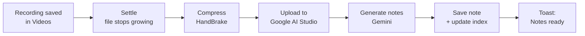
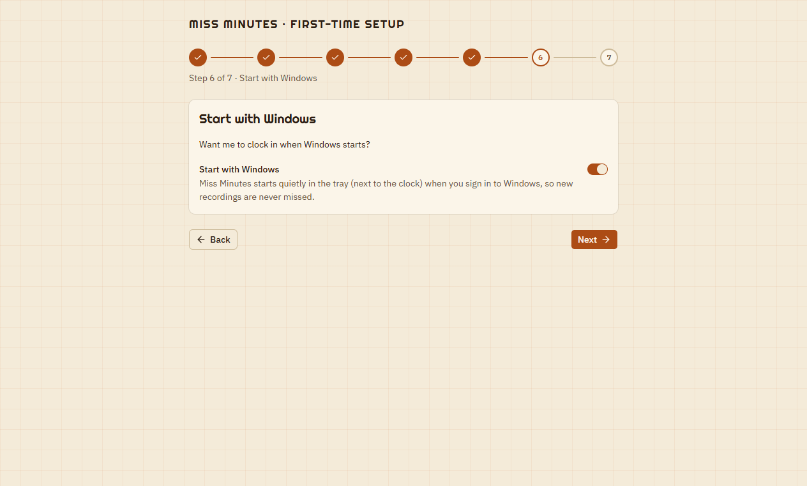

# Miss Minutes

Miss Minutes turns your meeting recordings into searchable meeting notes, automatically.

It watches the folder your recordings are saved to (for example OBS's `Videos` folder). Each new recording is compressed, uploaded to Google AI Studio and turned into a Markdown note with an overview, topics, decisions, action items and diagrams. The note is then filed in your library by category and tags. Everything runs on your own PC, in the background, from the system tray.


---

## Contents

- [How it works](#how-it-works)
- [Download and files](#download-and-files)
- [Requirements](#requirements)
- [Install and first-run setup](#install-and-first-run-setup)
- [Using Miss Minutes](#using-miss-minutes)
- [Google account](#google-account)
- [Where your data lives](#where-your-data-lives)
- [Uninstall](#uninstall)
- [Troubleshooting](#troubleshooting)
- [For developers](#for-developers)

---

## How it works



1. **Detect.** Every 60 s Miss Minutes scans the recordings folder. A new file waits until it stops changing for 2 minutes, so a recording still in progress is never picked up.
2. **Compress.** HandBrake shrinks the video (often to 20–40 % of its size), so the upload is fast.
3. **Generate.** A real Google Chrome, signed in to your Google account, opens AI Studio on a **hidden Windows desktop**. You never see a window or taskbar button. It uploads the video and asks Gemini for the notes.
4. **File.** The note is saved as Markdown under `notes/<category>/`, and the library index (`index.json` and `INDEX.md`) is updated. A Windows notification says the notes are ready.

If something fails, Miss Minutes retries on its own, up to 3 attempts per recording. If Google asks you to sign in again, the queue pauses and a notification asks you to sign in. After you sign in, processing resumes by itself.

---

## Download and files

| File | What it is |
|---|---|
| [`desktop/dist/Miss Minutes Setup 1.0.0.exe`](desktop/dist/Miss%20Minutes%20Setup%201.0.0.exe) | **The installer.** Run this to install or update Miss Minutes. |
| `%LOCALAPPDATA%\Programs\Miss Minutes\Miss Minutes.exe` | The installed app (Start menu → **Miss Minutes**). |
| `%LOCALAPPDATA%\Programs\Miss Minutes\Uninstall Miss Minutes.exe` | **The uninstaller** (Start menu → **Uninstall Miss Minutes**). See [Uninstall](#uninstall). |
| [`desktop/dist/win-unpacked/`](desktop/dist/win-unpacked) | The same app, unpacked, without installing (for testing). |

> The `desktop/dist` files are build output. If they are missing, build them with `npm run dist` (see [For developers](#for-developers)).

---

## Requirements

- Windows 10 or 11 (64-bit)
- **Google Chrome**. The setup wizard checks for it and offers **Download Chrome** if it is missing.
- A Google account that can use [Google AI Studio](https://aistudio.google.com)

You do **not** need Python, HandBrake or anything else: the installer includes them.

---

## Install and first-run setup

1. Run **`Miss Minutes Setup 1.0.0.exe`**. It installs for your user only, with no admin rights needed. You can choose the folder.
2. Miss Minutes starts and opens a short setup wizard.

| | |
|---|---|
| **1. Welcome**<br/>What Miss Minutes does. |  |
| **2. Google Chrome**<br/>Checks that Chrome is installed. If not, use **Download Chrome**, then **Check again**. |  |
| **3. Sign in to Google**<br/>**Sign in** opens a Chrome window: sign in to the account you use for AI Studio and the wizard notices by itself. **Skip for now** is fine too: Miss Minutes asks when it first needs it. |  |
| **4. Meeting notes**<br/>Where the library goes. An existing library is found and offered (it is used in place, nothing is copied), or start a new one in `Documents\Miss Minutes`, or pick any folder. |  |
| **5. Recordings**<br/>The folder your recordings are saved to (default: your `Videos` folder). |  |
| **6. Start with Windows**<br/>On: Miss Minutes starts quietly in the tray when you sign in to Windows, so no recording is missed. |  |
| **7. Done**<br/>A summary. **Start Miss Minutes** starts watching. |  |

You can change every choice later in **Settings**.

---

## Using Miss Minutes

Day to day there is nothing to do: record your meeting as usual, and the notes appear a few minutes after the recording ends.

### The tray icon

Closing the window does **not** quit Miss Minutes. It keeps running in the tray, next to the clock. Right-click the tray icon for:

- **Open Miss Minutes**
- **Pause watching** / **Resume watching**
- **Scan now**
- **Open library folder**
- **Quit**

If a video is being processed when you quit, Miss Minutes asks first. That video is processed again the next time it starts.

### Dashboard


- **Top card:** what is happening right now, with live progress (compressing %, upload, generation timer).
- **Counters:** done today and this week, failed, average processing time, and the disk space saved by compression.
- **Up next:** the waiting queue.
- **Add videos:** drag video files here, or use **Choose files**, to process a recording from anywhere. It is copied into the library and processed **first**, with no 2-minute wait.
- **Recently completed:** links to the newest notes.
- **Pause / Scan now** (bottom left): pause stops *new* videos from starting (the current one finishes); scan now looks for new recordings immediately.

### Queue


Everything waiting, running or failed, filtered with **All / Active / Pending / Failed**. The **⋯** menu on a row offers:
- **Open details**
- **Retry now**
- **Ignore**
- **Show source in folder**

Status words have a TVA theme. Hover a status to see its plain meaning:

| Shown as | Means |
|---|---|
| Pending | waiting its turn |
| Compressing / Generating | being processed |
| **Filed** | done, notes saved |
| **Pruned** | failed for good (all attempts used): use **Retry now** |
| **Archived** | was in the recordings folder before the library existed, or you ignored it. Not processed unless you **Include** it (Library → **Show ignored**). |

### Library


All your meetings. You can:
- search titles and summaries;
- filter by category, tags, date range or origin (watch folder or upload);
- group the list **flat**, **by category** or **by tag**.

The buttons at the top rebuild or open `INDEX.md` (a Markdown table of contents of all your notes) and open the library folder.

Categories: `flow-walkthrough`, `requirements`, `change-request`, `doubt-clearing`, `demo-review`, `technical-design`, `planning-status`, `other`.

### A meeting

Click any meeting to open it.

**Notes:** the generated note, with Mermaid diagrams and tables rendered. Timestamps like `[09:12]` point into the recording. Use **Open in editor** or **Copy markdown** to use the note elsewhere.


**Timeline:** every step of the run with its time and duration (settle, compress, AI Studio, upload, generate). A retried run branches off as a variant.


Buttons on a meeting:
- **Edit details:** change the title, category or tags. The note file moves to the new category folder.
- **Reprocess:** generate the notes again.
- **Open note** / **Show in folder.**
- **HandBrake log:** the compression log for this recording.

### Logs


The live engine log, with search and tag filters. This is the first place to look when something goes wrong.

### Settings


- **Health:** shows whether the engine, HandBrake, Chrome, the watch folder and the Google session are OK.
- **Watching:** the recordings folder, scan interval, settle time and the maximum number of attempts.
- **Compression:** HandBrake preset, encoder and quality. A higher RF gives smaller files.
- **Google account:** see [below](#google-account).
- **AI Studio:** the model, a fallback model, thinking level, language, retries and timeouts.
  - **Background context** (project names, usual attendees, domain terms) makes the notes noticeably more accurate.
  - **Show the automation browser** makes the hidden Chrome visible, for troubleshooting.
- **App:** the library folder, start at Windows login, start hidden, Miss Minutes' voice (the playful messages), theme (light *Office* or dark *CRT*), and developer mode.
- **Notifications:** choose which notifications you get: notes ready, final failure, every failure.

Changing a setting restarts the engine: after the current video by default, or right away if you choose.

---

## Google account


Settings → **Google account**:

- **Sign in:** opens a visible Chrome window. Sign in and it is picked up automatically.
- **Use a different account:** signs Google out first, so you can sign in with another account.
- **Sign out** / **Reset browser profile** (under *Troubleshooting*): forget the account, or start the automation browser from scratch.

These are refused while a video is being processed. Wait for it to finish, or pause first.

**When your Google session expires:** the video goes back to the queue without using up an attempt, and the worker pauses. A notification, *"Your Google session expired…"*, and a red banner appear. Click either one and sign in, and processing continues by itself.

The automation Chrome uses its **own** profile, separate from your everyday Chrome.

---

## Where your data lives

| What | Where | Removed by uninstall? |
|---|---|---|
| The app | `%LOCALAPPDATA%\Programs\Miss Minutes` | Yes |
| **Library**: notes, `index.json`, `INDEX.md`, compressed videos, uploads, logs | `Documents\Miss Minutes` by default, or the folder you chose (Settings → App → Library folder) | **Only if you say Yes** |
| Settings, Google sign-in (automation browser profile), app logs | `%APPDATA%\Miss Minutes` | **Only if you say Yes** |
| Your original recordings | your recordings folder (e.g. `Videos`) | **Never** |

Back up the library folder to keep your notes safe. It is plain files (Markdown and JSON).

---

## Uninstall

Open **Start menu → Uninstall Miss Minutes**, or **Windows Settings → Apps → Installed apps → Miss Minutes → Uninstall**.

Miss Minutes is closed automatically, including its background engine and hidden Chrome. The uninstaller then asks **two questions**. **Both default to No**, so pressing Enter twice removes only the app and keeps all your data.

**1. "Also delete your Miss Minutes library?"**

The dialog shows the library's folder.
- **No (recommended):** the library stays exactly where it is. Installing Miss Minutes again finds it and offers it in the setup wizard.
- **Yes:** permanently deletes that folder: all notes, the index and the compressed videos. **This cannot be undone.**

This question only appears when the app uses a library of its own (one with an `index.json`). A library used in developer mode is never offered for deletion.

> ⚠️ **Read the path in the dialog before answering.** If you pointed Miss Minutes at an existing library during setup (for example the project's `library` folder), that is the folder it shows, and **Yes** would delete it.

**2. "Also delete your settings and Google sign-in?"**

This is `%APPDATA%\Miss Minutes`: settings, the automation browser profile and app logs.
- **No:** a reinstall keeps your settings and Google sign-in.
- **Yes:** a completely fresh start. The setup wizard and Google sign-in run again after reinstalling.

### Common choices

| You want to… | Library? | Settings? |
|---|---|---|
| Remove the app but keep everything (e.g. reinstall later) | No | No |
| **Retest from a fresh install, keeping your notes** | **No** | **Yes** |
| Remove absolutely everything | Yes | Yes |

**A fresh retest, step by step:**
1. Quit Miss Minutes from the tray.
2. Start menu → **Uninstall Miss Minutes**. Answer **No** to the library and **Yes** to settings.
3. Run `Miss Minutes Setup 1.0.0.exe` again. The wizard starts from scratch and offers your existing library.

**Silent uninstall** (scripts): `"%LOCALAPPDATA%\Programs\Miss Minutes\Uninstall Miss Minutes.exe" /S` asks nothing and keeps all data.

**Installing a new version over the old one** also asks nothing and keeps all data.

> The uninstaller learns where the library is when Miss Minutes starts. If you have never started the installed app, it won't offer to delete the library.

---

## Troubleshooting

| Problem | What to do |
|---|---|
| A recording is never picked up | Check Settings → Watching → watch folder. The file must stop changing for the settle time (2 min). A recording that was there before the library existed is *Archived*: Library → **Show ignored** → **Include**. |
| A video shows **Pruned** (failed) | Open it → **Logs** tab to see why, then **Retry now**. |
| "Your Google session expired" | Click the notification or the banner's **Sign in**, then sign in in the Chrome window. |
| I want to see what Chrome is doing | Settings → AI Studio → turn **Show the automation browser** on. |
| Health shows Chrome missing | Install Google Chrome, then restart Miss Minutes. |
| Something else | Logs page; the library's `logs/` folder holds the full logs. |

---

## For developers

The desktop app (Electron + React) lives in [`desktop/`](desktop/README.md). The engine is the Python pipeline in this folder: [`watcher.py`](watcher.py) and [`meeting_notes.py`](meeting_notes.py).

**Build the installer:**

```bash
cd desktop
npm install
npm run dist       # engine (PyInstaller) + app + installer -> desktop/dist/Miss Minutes Setup <version>.exe
npm run dist:app   # app + installer only, reusing the last engine build
```

**Run in development:** `cd desktop && npm run dev`.

**Developer mode** (Settings → App → *Project folder*): the app runs this folder's `.venv\Scripts\python.exe watcher.py` instead of the bundled engine, so Python changes need no rebuild.

**Command line (no app):**

```bash
python watcher.py watch            # watch the Videos folder and process new recordings
python watcher.py watch --once     # process what is ready, then exit
python watcher.py list --category requirements --tag decisions
python watcher.py reindex          # rebuild INDEX.md
python watcher.py check            # health checks as one JSON line
python watcher.py signin           # open Chrome to sign in to Google
```

Use `--help` on any command for every option. Don't run the command-line watcher on the same library while the app is running: a lock allows only one at a time.

**Tests:**

```bash
.venv/Scripts/python.exe -m pytest tests     # Python
cd desktop && npm run typecheck && npx eslint src scripts *.ts *.mjs && npx prettier --check src scripts
```

Design and plans: [`.claude/plans/desktop-app/`](.claude/plans/desktop-app/00-INDEX.md).

---

*Screenshots show a demo library with made-up meetings.*
