# Miss Minutes

<p align="center"></p>

Miss Minutes turns your meeting recordings into searchable meeting notes, automatically.

Record the meeting from Miss Minutes itself, or with any recorder you already use (for example OBS): it watches the folder your recordings are saved to. Each new recording is compressed, uploaded to Google AI Studio and turned into a Markdown note with an overview, topics, decisions, action items and diagrams. The note is then filed in your library by category and tags. Everything runs on your own PC, in the background, from the system tray.

## Highlights

- **Built-in meeting recorder.** Record any screen or window with the call's audio and your mic, no OBS needed. Start from the header, the tray or **Ctrl+Alt+R**; mute your mic mid-meeting with **Ctrl+Alt+M**.
- **Floating REC toolbar.** While you're in Zoom, Teams or Meet, a small always-on-top pill shows the time with **Mute** and **Stop**. It stays out of the recording itself.
- **Meeting notes, automatically.** Every recording (made in the app, by OBS or dropped in) is compressed and turned by Gemini into a Markdown note: overview, topics, decisions, action items and diagrams. Timestamps in the note play the recording from that moment.
- **An organised library.** Notes are filed by category and tags. Filter, group, edit, reprocess, or delete meetings (one or many at once, to the Recycle Bin).
- **Search your notes.** Full-text search, plus optional smart search by meaning that runs entirely on your PC.
- **Runs quietly in the background.** From the system tray, starting with Windows: failures are retried, and a notification tells you when notes are ready.
- **Updates itself.** New versions download in the background; restart to install, or it installs the next time you quit.
- **Your data stays yours.** The library lives on your PC; recordings are only sent to your own Google AI Studio account to write the notes.

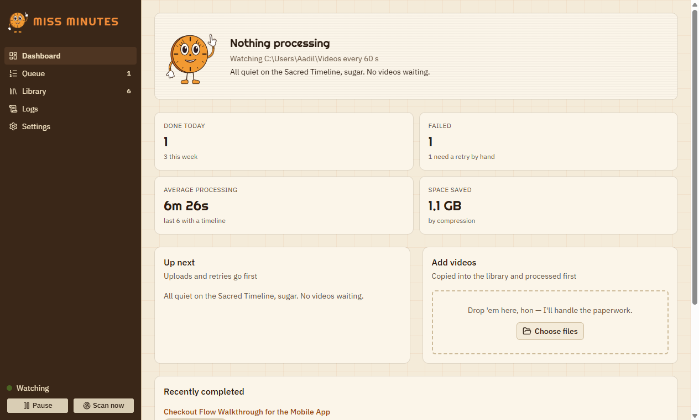

---

## Contents

- [How it works](#how-it-works)
- [Download and files](#download-and-files)
- [Requirements](#requirements)
- [Install and first-run setup](#install-and-first-run-setup)
- [Using Miss Minutes](#using-miss-minutes)
- [Google account](#google-account)
- [Where your data lives](#where-your-data-lives)
- [Uninstall](#uninstall)
- [Troubleshooting](#troubleshooting)
- [For developers](#for-developers)

---

## How it works

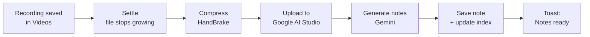

1. **Detect.** Every 60 s Miss Minutes scans the recordings folder. A new file waits until it stops changing for 2 minutes, so a recording still in progress is never picked up. A meeting recorded in Miss Minutes itself skips the wait: it is queued, first, the moment you stop it.
2. **Compress.** HandBrake shrinks the video (often to 20–40 % of its size), so the upload is fast.
3. **Generate.** A real Google Chrome, signed in to your Google account, opens AI Studio on a **hidden Windows desktop**. You never see a window or taskbar button. It uploads the video and asks Gemini for the notes.
4. **File.** The note is saved as Markdown under `notes/<category>/`, and the library index (`index.json` and `INDEX.md`) is updated. A Windows notification says the notes are ready.

If something fails, Miss Minutes retries on its own, up to 3 attempts per recording. If Google asks you to sign in again, the queue pauses and a notification asks you to sign in. After you sign in, processing resumes by itself.

---

## Download and files

| File | What it is |
|---|---|
| [**Download `Miss-Minutes-Setup-1.4.0.exe`**](https://github.com/CODE-AXION/Miss-Minutes/releases/latest/download/Miss-Minutes-Setup-1.4.0.exe) | **The installer.** Run this to install or update Miss Minutes. All versions are on the [Releases](https://github.com/CODE-AXION/Miss-Minutes/releases) page. |
| `%LOCALAPPDATA%\Programs\Miss Minutes\Miss Minutes.exe` | The installed app (Start menu → **Miss Minutes**). |
| `%LOCALAPPDATA%\Programs\Miss Minutes\Uninstall Miss Minutes.exe` | **The uninstaller** (Start menu → **Uninstall Miss Minutes**). See [Uninstall](#uninstall). |
| `desktop/dist/win-unpacked/` | The same app, unpacked, without installing (for testing). Local build output only. |

> The installer is not stored in the repository (it is too large for git). It is attached to each [GitHub Release](https://github.com/CODE-AXION/Miss-Minutes/releases). To build it yourself, run `npm run dist` (see [For developers](#for-developers)); it lands in `desktop/dist/`.

---

## Requirements

- Windows 10 or 11 (64-bit)
- **Google Chrome**. The setup wizard checks for it and offers **Download Chrome** if it is missing.
- A Google account that can use [Google AI Studio](https://aistudio.google.com)

You do **not** need Python, HandBrake, OBS or anything else: the installer includes them, and Miss Minutes can record meetings itself.

---

## Install and first-run setup

1. Run **`Miss-Minutes-Setup-1.4.0.exe`** ([download](https://github.com/CODE-AXION/Miss-Minutes/releases/latest/download/Miss-Minutes-Setup-1.4.0.exe)). It installs for your user only, with no admin rights needed. You can choose the folder.
2. Miss Minutes starts and opens a short setup wizard.

| | |
|---|---|
| **1. Welcome**<br/>What Miss Minutes does. | 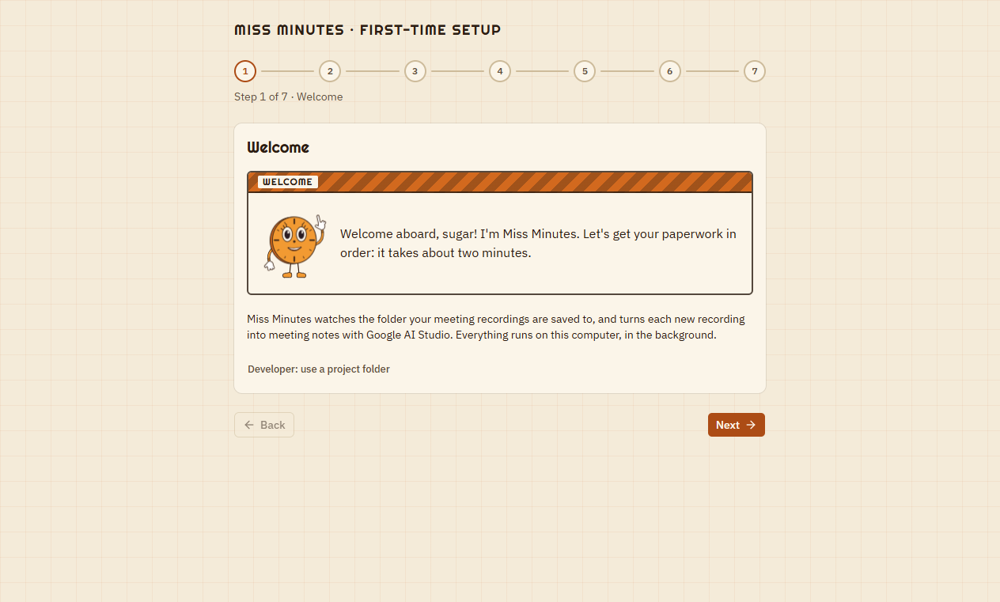 |
| **2. Google Chrome**<br/>Checks that Chrome is installed. If not, use **Download Chrome**, then **Check again**. | 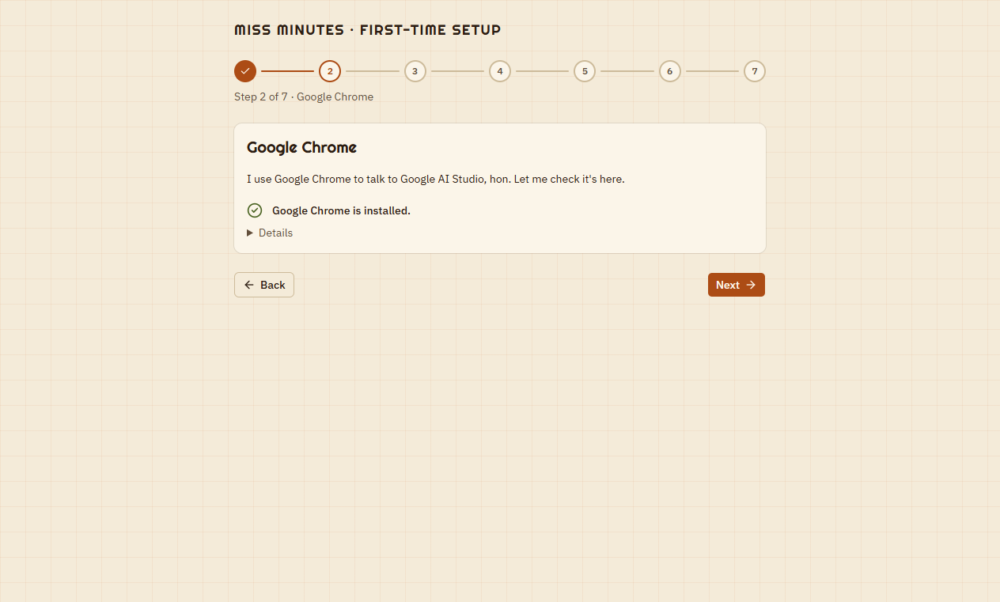 |
| **3. Sign in to Google**<br/>**Sign in** opens a Chrome window: sign in to the account you use for AI Studio and the wizard notices by itself. **Skip for now** is fine too: Miss Minutes asks when it first needs it. | 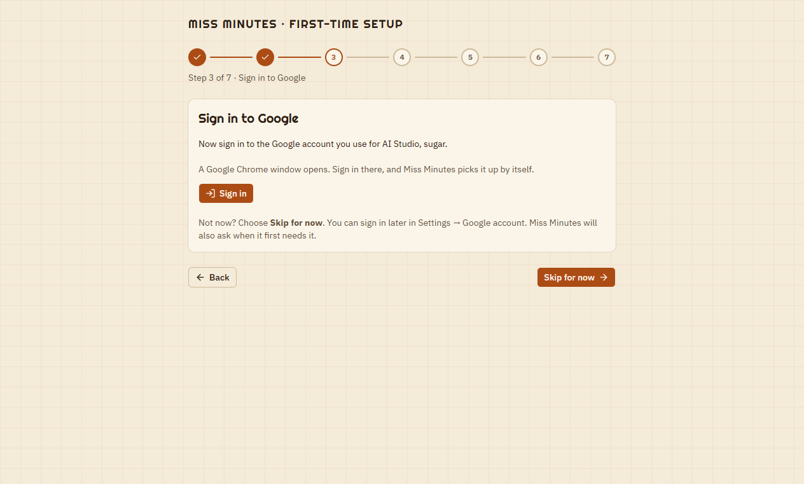 |
| **4. Meeting notes**<br/>Where the library goes. An existing library is found and offered (it is used in place, nothing is copied), or start a new one in `Documents\Miss Minutes`, or pick any folder. | 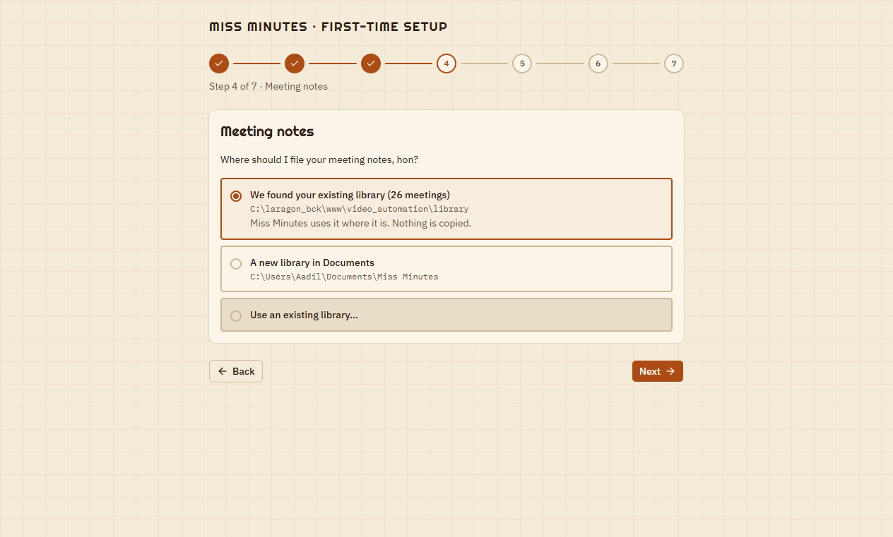 |
| **5. Smart search**<br/>Optional: search your notes by meaning, not just by keyword. **Not now** is preselected. **Turn on smart search** downloads a 207 MB search model once, after you start; nothing leaves your PC. See [Searching your notes](#searching-your-notes). | 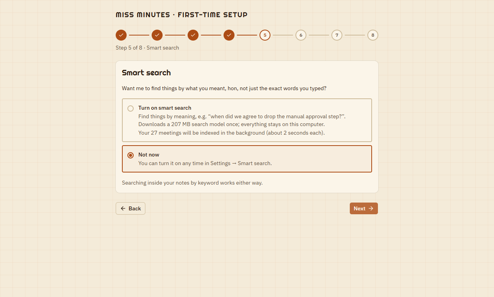 |
| **6. Recordings**<br/>The folder your recordings are saved to (default: your `Videos` folder). Recordings made in Miss Minutes go here too; if you also use OBS, pick the folder OBS saves to. | 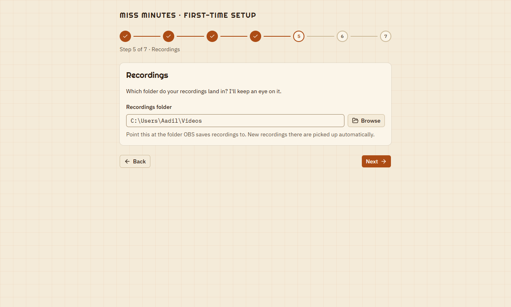 |
| **7. Start with Windows**<br/>On: Miss Minutes starts quietly in the tray when you sign in to Windows, so no recording is missed. |  |
| **8. Done**<br/>A summary. **Start Miss Minutes** starts watching. | 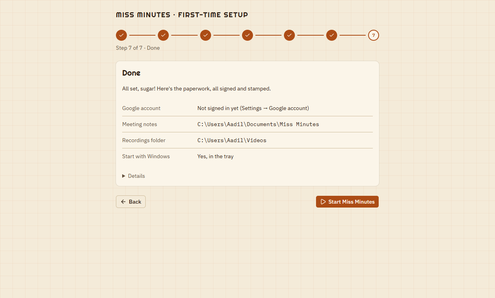 |

You can change every choice later in **Settings**.

---

## Using Miss Minutes

Day to day there is nothing to do: record your meeting (in Miss Minutes or with your usual recorder), and the notes appear a few minutes after the recording ends.

### Updates

Miss Minutes checks GitHub for a new version when it starts and every few hours, and downloads it in the background. When it is ready, the header shows **Update … ready · Restart**, the tray menu offers **Restart to update**, and a notification tells you. It never restarts during a recording or while a video is being processed; if you ignore it, the update installs the next time Miss Minutes quits. Your library and settings are kept.

### The tray icon

Closing the window does **not** quit Miss Minutes. It keeps running in the tray, next to the clock. Right-click the tray icon for:

- **Open Miss Minutes**
- **Start recording…** / **Stop recording**, and **Mute microphone** while recording (see [Recording meetings in the app](#recording-meetings-in-the-app))
- **Pause watching** / **Resume watching**
- **Scan now**
- **Open library folder**
- **Quit**

If a video is being processed when you quit, Miss Minutes asks first. That video is processed again the next time it starts.

### Dashboard


- **Top card:** what is happening right now, with live progress (compressing %, upload, generation timer).
- **Counters:** done today and this week, failed, average processing time, and the disk space saved by compression.
- **Up next:** the waiting queue.
- **Add videos:** drag video files here, or use **Choose files**, to process a recording from anywhere. It is copied into the library and processed **first**, with no 2-minute wait.
- **Recently completed:** links to the newest notes.
- **Smart search card:** appears only while smart search is being set up (download, then indexing) and hides itself when it is ready. If it fails, it shows the reason and **Retry**.
- **Pause / Scan now** (bottom left): pause stops *new* videos from starting (the current one finishes); scan now looks for new recordings immediately.

### Recording meetings in the app

You don't need OBS: Miss Minutes can record the meeting itself.

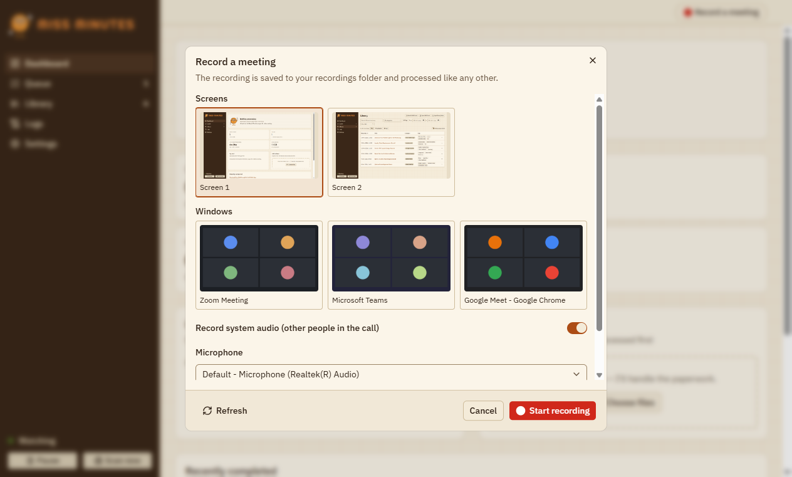

1. Click **Record a meeting** in the header at the top right of every page, choose **Start recording…** in the tray menu, or press **Ctrl+Alt+R** from any app.
2. Pick the screen or window to record, whether to record the **system audio** (the other people in the call), and your **microphone**. Your last choice is preselected.
3. **Start recording.** A red **REC 00:12** pill shows in the header, next to what is being recorded, and the tray icon turns red, with the elapsed time in its tooltip. You can close the window: recording carries on in the tray.

   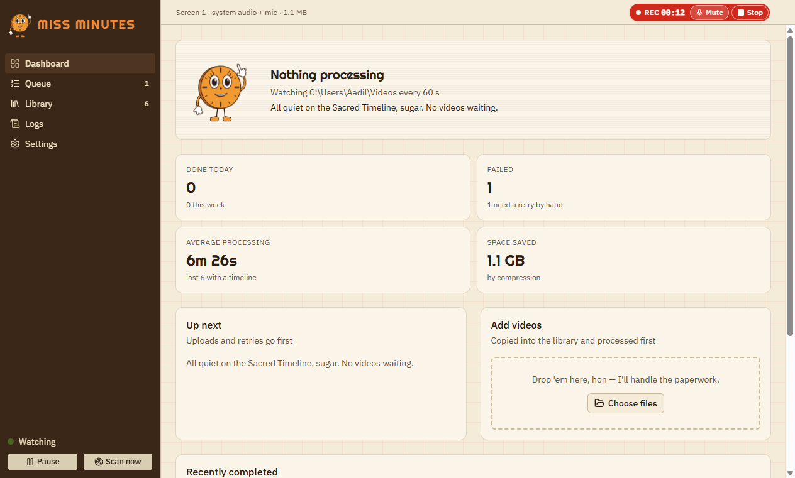
4. Stop with **Stop** in the header, the tray's **Stop recording**, or **Ctrl+Alt+R** again.

**Mute your mic** without stopping: **Mute** in the header, **Mute microphone** in the tray, or **Ctrl+Alt+M**. Only the mic is silenced in the recording; the screen and the call's audio keep recording. It doesn't mute you in Zoom or Teams (and muting there doesn't mute the recording).

The recording is saved as an MP4 in your recordings folder (named like `2026-10-19 14-03-27.mp4`, like OBS does) and goes to the front of the queue. From there it is compressed and turned into notes like any other recording.

- **Floating toolbar.** While recording, a small red **REC** pill with **Mute** and **Stop** floats on top of your meeting app whenever Miss Minutes isn't the window in front (top centre of the screen at first; drag it anywhere and it stays there). It is left out of the recording itself. Turn it off in **Settings → Recording**.

  
- **Use headphones.** Through speakers, the other people are recorded twice (by the system audio and by the mic).
- If Windows blocks the microphone, or the system audio can't be captured, the recording still runs with what is available and the header says what is missing.
- If the recorded window is closed, or the drive is almost full, the recording stops and is saved by itself.
- **OBS still works.** Anything saved to the recordings folder is picked up as before; both kinds sit in the same library.
- Change or turn off the shortcuts in **Settings → Recording**.

### Queue

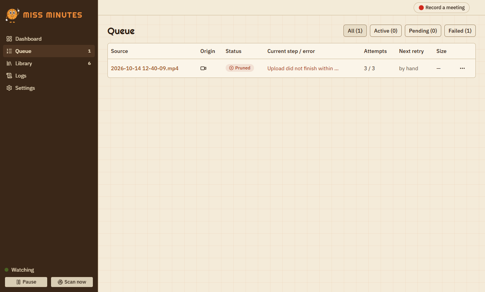

Everything waiting, running or failed, filtered with **All / Active / Pending / Failed**. The **⋯** menu on a row offers:
- **Open details**
- **Retry now**
- **Ignore**
- **Show source in folder**

Status words have a TVA theme. Hover a status to see its plain meaning:

| Shown as | Means |
|---|---|
| Pending | waiting its turn |
| Compressing / Generating | being processed |
| **Filed** | done, notes saved |
| **Pruned** | failed for good (all attempts used): use **Retry now** |
| **Archived** | was in the recordings folder before the library existed, or you ignored it. Not processed unless you **Include** it (Library → **Show ignored**). |

### Library

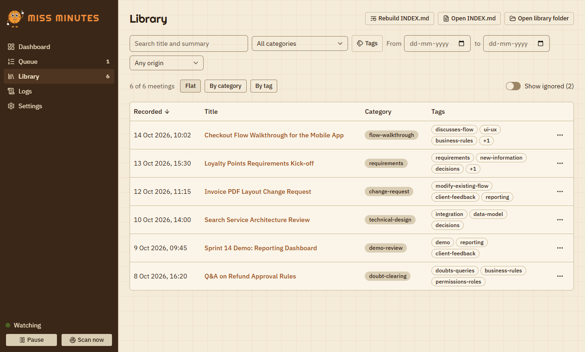

All your meetings. You can:
- search inside the full text of every note (see [Searching your notes](#searching-your-notes));
- filter by category, tags, date range or origin (watch folder or upload);
- group the list **flat**, **by category** or **by tag**.

**Deleting meetings:** use **Delete…** in a row's **⋯** menu, or **Delete** on the meeting's page. To delete several at once, tick their checkboxes (the box in the header ticks the whole list or group) and click **Delete…** in the bar at the bottom. You choose:
- **Delete the note only:** the recording stays, listed as not processed (it is not turned into notes again unless you **Include** it);
- **Delete the note and the video:** the recording and its compressed copy go too, and the meeting leaves the library.

Everything deleted goes to the Windows **Recycle Bin**, so you can restore it from there.

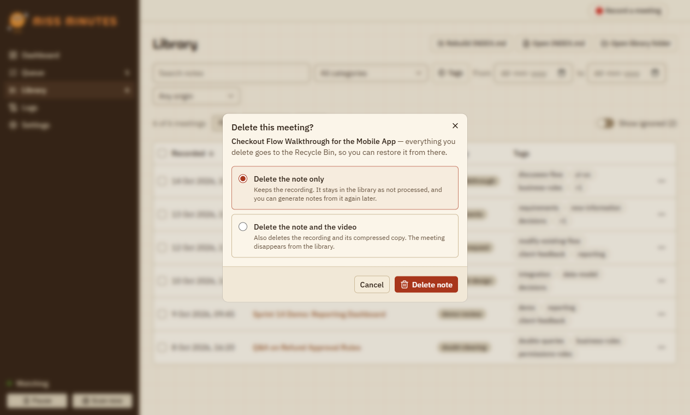

The buttons at the top rebuild or open `INDEX.md` (a Markdown table of contents of all your notes) and open the library folder.

Categories: `flow-walkthrough`, `requirements`, `change-request`, `doubt-clearing`, `demo-review`, `technical-design`, `planning-status`, `other`.

### Searching your notes

Type in the Library's **Search notes** box. Results replace the table as you type: the matching **passages**, grouped by meeting, not just whole meetings. A passage is a decision, an action item, a question with its answer, a business rule, a glossary term or a note bullet. Each one shows its section and its `[MM:SS]` timestamp, with the matching words highlighted. Click a passage to open the note scrolled to that section.

The category, tag, date and origin filters still apply on top of the search.

**Keyword search** works for everyone, with no download. It matches the words you type, e.g. `duplicate invoice`.

**Smart search** (optional) finds things by meaning, so the words don't have to match. Type a question, e.g. *"when did we agree to drop the manual approval step?"*, and press **Enter**.
- Turn it on in the setup wizard or in **Settings → Smart search**.
- The first time, it downloads a 207 MB search model and then indexes your meetings in the background (about 2 seconds each). Search keeps working by keyword meanwhile, and the Settings card and the dashboard show the progress.
- It runs entirely on your PC: your notes are never sent anywhere. A search takes a few hundredths of a second.
- New and edited notes are indexed automatically.
- Turning it off keeps the downloaded files, so turning it on again is instant. Tick **Also delete downloaded files** to free the space instead (about 210 MB).

### A meeting

Click any meeting to open it.

**Notes:** the generated note, with Mermaid diagrams and tables rendered. Click a timestamp like `[09:12]` to play the recording from that moment in a player docked beside the note (it starts 2 seconds early; **Esc** or **✕** closes it). Use **Open in editor** or **Copy markdown** to use the note elsewhere.

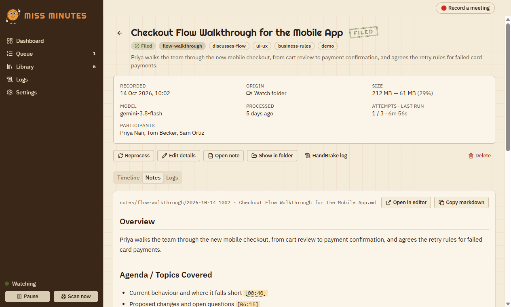

**Timeline:** every step of the run with its time and duration (settle, compress, AI Studio, upload, generate). A retried run branches off as a variant.

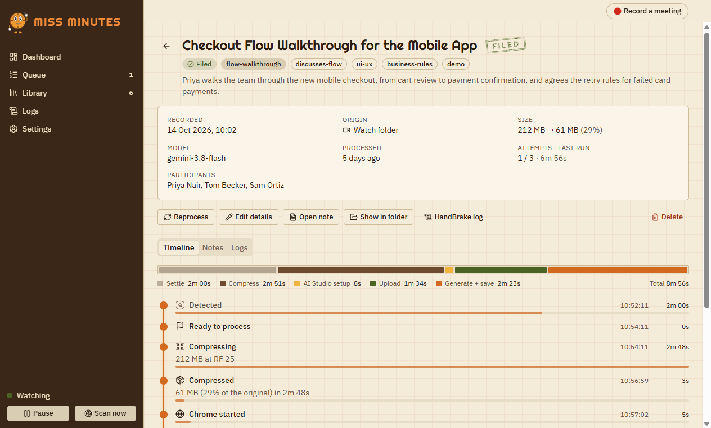

Buttons on a meeting:
- **Edit details:** change the title, category or tags. The note file moves to the new category folder.
- **Reprocess:** generate the notes again.
- **Open note** / **Show in folder.**
- **HandBrake log:** the compression log for this recording.

### Logs

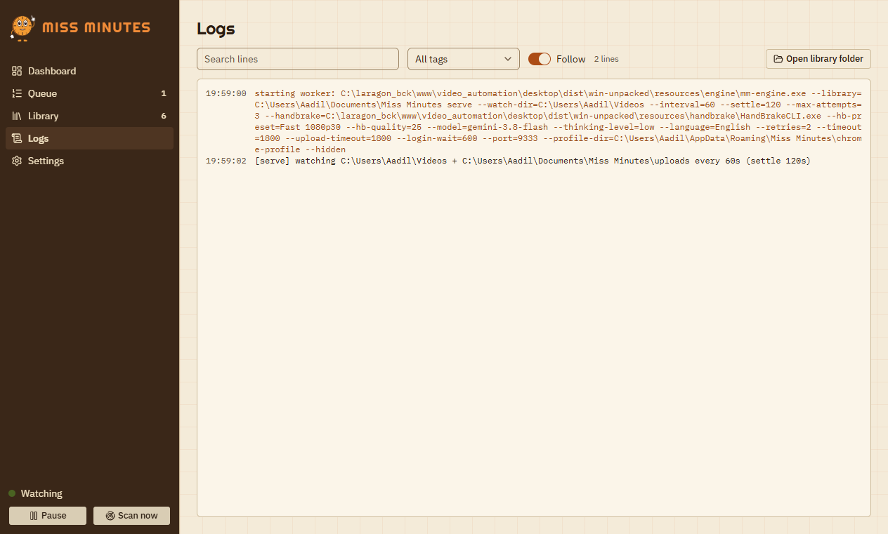

The live engine log, with search and tag filters. This is the first place to look when something goes wrong.

### Settings

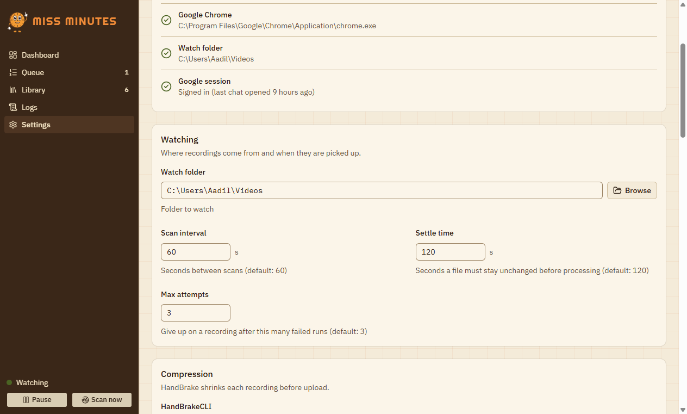

- **Health:** shows whether the engine, HandBrake, Chrome, the watch folder and the Google session are OK.
- **Watching:** the recordings folder, scan interval, settle time and the maximum number of attempts.
- **Recording:** the start/stop and mute shortcuts (**Change**, **Reset**, **Turn off**), and the floating toolbar on/off. It takes effect right away; a shortcut another app already uses is refused.

  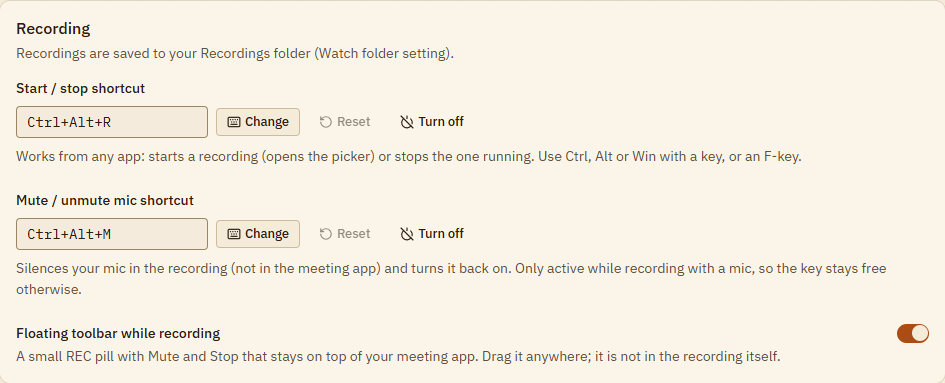
- **Compression:** HandBrake preset, encoder and quality. A higher RF gives smaller files.
- **Google account:** see [below](#google-account).
- **AI Studio:** the model, a fallback model, thinking level, language, retries and timeouts.
  - **Background context** (project names, usual attendees, domain terms) makes the notes noticeably more accurate.
  - **Show the automation browser** makes the hidden Chrome visible, for troubleshooting.
- **Smart search:** turn meaning-based search on or off, watch the download and indexing, **Retry** after a failure, **Rebuild index**, and delete the downloaded files. It takes effect right away (no Save) and never restarts the engine.
- **App:** the library folder, start at Windows login, start hidden, Miss Minutes' voice (the playful messages), theme (light *Office* or dark *CRT*), and developer mode.
- **Notifications:** choose which notifications you get: notes ready, final failure, every failure.
- **Updates:** the version you run, **Check for updates**, and **Restart to update** once a new version is downloaded.

Changing a setting restarts the engine: after the current video by default, or right away if you choose.

---

## Google account

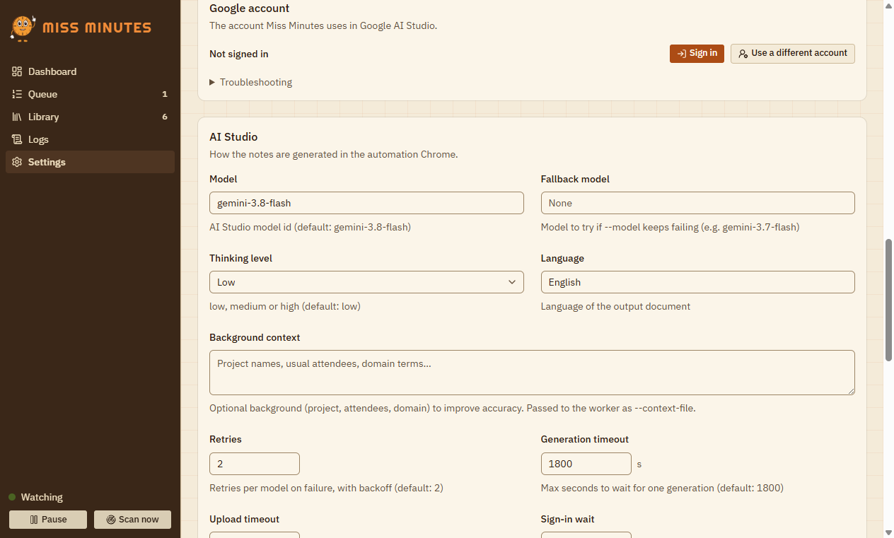

Settings → **Google account**:

- **Sign in:** opens a visible Chrome window. Sign in and it is picked up automatically.
- **Use a different account:** signs Google out first, so you can sign in with another account.
- **Sign out** / **Reset browser profile** (under *Troubleshooting*): forget the account, or start the automation browser from scratch.

These are refused while a video is being processed. Wait for it to finish, or pause first.

**When your Google session expires:** the video goes back to the queue without using up an attempt, and the worker pauses. A notification, *"Your Google session expired…"*, and a red banner appear. Click either one and sign in, and processing continues by itself.

The automation Chrome uses its **own** profile, separate from your everyday Chrome.

---

## Where your data lives

| What | Where | Removed by uninstall? |
|---|---|---|
| The app | `%LOCALAPPDATA%\Programs\Miss Minutes` | Yes |
| **Library**: notes, `index.json`, `INDEX.md`, compressed videos, uploads, logs | `Documents\Miss Minutes` by default, or the folder you chose (Settings → App → Library folder) | **Only if you say Yes** |
| Settings, Google sign-in (automation browser profile), app logs | `%APPDATA%\Miss Minutes` | **Only if you say Yes** |
| Smart search model (only if you turned it on, about 207 MB) | `%APPDATA%\Miss Minutes\models` | **Only if you say Yes** (the settings question) |
| Search index | `.search` folder inside the library | With the library (**only if you say Yes**) |
| Your original recordings | your recordings folder (e.g. `Videos`) | **Never** |

Back up the library folder to keep your notes safe. It is plain files (Markdown and JSON).

---

## Uninstall

Open **Start menu → Uninstall Miss Minutes**, or **Windows Settings → Apps → Installed apps → Miss Minutes → Uninstall**.

Miss Minutes is closed automatically, including its background engine and hidden Chrome. The uninstaller then asks **two questions**. **Both default to No**, so pressing Enter twice removes only the app and keeps all your data.

**1. "Also delete your Miss Minutes library?"**

The dialog shows the library's folder.
- **No (recommended):** the library stays exactly where it is. Installing Miss Minutes again finds it and offers it in the setup wizard.
- **Yes:** permanently deletes that folder: all notes, the index and the compressed videos. **This cannot be undone.**

This question only appears when the app uses a library of its own (one with an `index.json`). A library used in developer mode is never offered for deletion.

> ⚠️ **Read the path in the dialog before answering.** If you pointed Miss Minutes at an existing library during setup (for example the project's `library` folder), that is the folder it shows, and **Yes** would delete it.

**2. "Also delete your settings and Google sign-in?"**

This is `%APPDATA%\Miss Minutes`: settings, the automation browser profile, app logs and the downloaded smart search model.
- **No:** a reinstall keeps your settings and Google sign-in.
- **Yes:** a completely fresh start. The setup wizard and Google sign-in run again after reinstalling.

### Common choices

| You want to… | Library? | Settings? |
|---|---|---|
| Remove the app but keep everything (e.g. reinstall later) | No | No |
| **Retest from a fresh install, keeping your notes** | **No** | **Yes** |
| Remove absolutely everything | Yes | Yes |

**A fresh retest, step by step:**
1. Quit Miss Minutes from the tray.
2. Start menu → **Uninstall Miss Minutes**. Answer **No** to the library and **Yes** to settings.
3. Run `Miss-Minutes-Setup-1.4.0.exe` again. The wizard starts from scratch and offers your existing library.

**Silent uninstall** (scripts): `"%LOCALAPPDATA%\Programs\Miss Minutes\Uninstall Miss Minutes.exe" /S` asks nothing and keeps all data.

**Installing a new version over the old one** also asks nothing and keeps all data.

> The uninstaller learns where the library is when Miss Minutes starts. If you have never started the installed app, it won't offer to delete the library.

---

## Troubleshooting

| Problem | What to do |
|---|---|
| A recording is never picked up | Check Settings → Watching → watch folder. The file must stop changing for the settle time (2 min). A recording that was there before the library existed is *Archived*: Library → **Show ignored** → **Include**. |
| A video shows **Pruned** (failed) | Open it → **Logs** tab to see why, then **Retry now**. |
| "Your Google session expired" | Click the notification or the banner's **Sign in**, then sign in in the Chrome window. |
| I want to see what Chrome is doing | Settings → AI Studio → turn **Show the automation browser** on. |
| Health shows Chrome missing | Install Google Chrome, then restart Miss Minutes. |
| Something else | Logs page; the library's `logs/` folder holds the full logs. |

---

## For developers

The desktop app (Electron + React) lives in [`desktop/`](desktop/README.md). The engine is the Python pipeline in this folder: [`watcher.py`](watcher.py) and [`meeting_notes.py`](meeting_notes.py).

**Build the installer:**

```bash
cd desktop
npm install
npm run dist       # engine (PyInstaller) + app + installer -> desktop/dist/Miss-Minutes-Setup-<version>.exe
npm run dist:app   # app + installer only, reusing the last engine build
```

**Release a version** (the app updates itself from GitHub Releases):

1. Bump `version` in `desktop/package.json`, then `npm run dist`.
2. Create a GitHub release tagged `v<version>` and upload **all three** files from `desktop/dist/`: `Miss-Minutes-Setup-<version>.exe`, its `.exe.blockmap`, and `latest.yml`. Installed apps read `latest.yml` from the newest release, so without it nobody is offered the update.
3. Publish it (not as a draft or pre-release). Running apps find it within 4 hours, or at once with **Settings → Updates → Check for updates**.

**Run in development:** `cd desktop && npm run dev`.

**Developer mode** (Settings → App → *Project folder*): the app runs this folder's `.venv\Scripts\python.exe watcher.py` instead of the bundled engine, so Python changes need no rebuild.

**Command line (no app):**

```bash
python watcher.py watch            # watch the Videos folder and process new recordings
python watcher.py watch --once     # process what is ready, then exit
python watcher.py list --category requirements --tag decisions
python watcher.py reindex          # rebuild INDEX.md
python watcher.py check            # health checks as one JSON line
python watcher.py signin           # open Chrome to sign in to Google
```

Use `--help` on any command for every option. Don't run the command-line watcher on the same library while the app is running: a lock allows only one at a time.

**Tests:**

```bash
.venv/Scripts/python.exe -m pytest tests     # Python
cd desktop && npm test                       # desktop unit tests (vitest)
cd desktop && npm run typecheck && npx eslint src scripts *.ts *.mjs && npx prettier --check src scripts
```

Design and plans: [`.claude/plans/desktop-app/`](.claude/plans/desktop-app/00-INDEX.md).

---

*Screenshots show a demo library with made-up meetings.*
