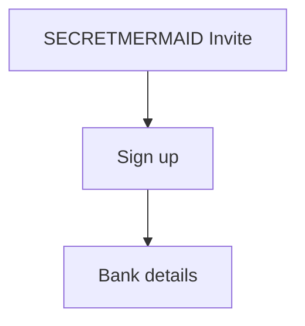

# Payroll Portal Onboarding Review

## Overview
The team reviewed the new payroll portal onboarding flow end to end. Priya Nair demonstrated employee invitations, bank detail validation and the approval queue, and the group agreed on the launch checklist.

## Agenda / Topics Covered
- **[00:00] - Employee Invitations:** Priya Nair shows how HR invites a new employee by email and how the invite expires.
- **[03:12] - Bank Detail Validation:** Walkthrough of the IBAN check and what the employee sees when the number is rejected.
- **[07:40] - Approval Queue:** How managers approve or reject onboarding requests and how reminders are sent each day.
- [09:55] Wrap-up.

---

## Process Flow
The onboarding flow:

1. **Invite:** HR enters the employee email and the portal sends an invitation link that is valid for 7 days.
2. **Sign up:** The employee opens the link, sets a password and confirms their phone number with a one-time code.
3. **Bank details:** The employee enters an IBAN; the portal validates the checksum and the bank code.
4. **Tax form:** The employee uploads the signed tax form as a PDF of at most 5 MB.
5. **Approval:** The manager reviews the request in the approval queue and approves or rejects it with a reason.
6. **Payroll sync:** Approved employees are synced to the payroll system at the next nightly run.

---

## Business Logic & Rules

| Rule | Details / Conditions | Timestamp |
| :--- | :--- | :--- |
| **Invite expiry** | An invitation link expires after 7 days and HR must resend it; expired links show a friendly error page. | [01:45] |
| **IBAN validation** | The IBAN checksum must pass and the bank code must exist in the bank directory, otherwise the step is blocked. | [04:30] |

## Key Terms & Glossary

| Term | Meaning in this context |
| :--- | :--- |
| **Approval queue** | The list of onboarding requests waiting for a manager decision, sorted by the date they were submitted. |
| **Nightly run** | The scheduled batch job at 02:00 that copies approved employees from the portal into the payroll system. |

## Doubts Raised & Resolutions

**Q [05:02] (Tom Becker):** What happens if an employee enters a valid IBAN for a closed bank account?  
**A (Priya Nair):** The checksum passes, so the portal accepts it; the first payroll run then fails and HR is notified by email.

**Q [08:10] (Lena Ortiz):** Can a manager approve their own onboarding request?  
**A (Priya Nair / Tom Becker):** No. Self-approval is blocked and the request is routed to the manager's own manager instead.

## Decisions Made
- **[06:20]** Rejected IBANs will show the bank name the portal expected, so employees can spot typos faster.
- **[09:30]** Launch the portal to the Berlin office first and to all other offices two weeks later.

## Action Items

| Owner | Task | Due / Priority (if mentioned) | Timestamp |
| :--- | :--- | :--- | :--- |
| **Priya Nair** | Add the expected bank name to the IBAN rejection message in the bank details step. | High | [06:20] |
| **Tom Becker** | Write the Berlin launch announcement and send it to the office managers for review. | Next week | [09:30] |

## Important Notes
- The payroll system rejects employees without a tax form, so the tax form step must never become optional.

## Open Questions / Follow-ups
_None discussed._

## Something New
This section heading is not in the prompt today, and the chunker must still index its text as a plain note.
